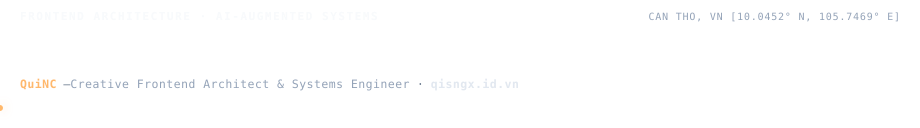
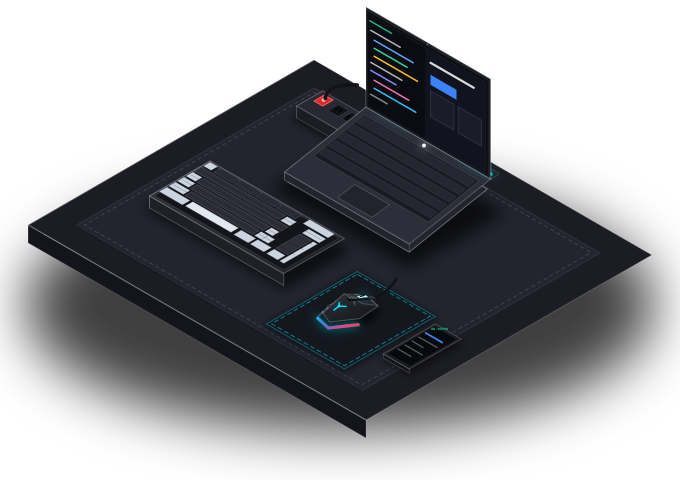

  

  

# Nguyễn Cao Quí (QuiNC)

**Creative Frontend Architect & AI-Augmented Systems Engineer** based in Can Tho, Vietnam [10.0452° N, 105.7469° E]. Engineering high-performance web applications, GPU graphics pipelines (WebGL/GLSL), and edge-native architectures. Official hub: **[qisngx.id.vn](https://qisngx.id.vn)**.

- **Craft Philosophy**: Precision & Architecture — AST call graphs, sub-pixel rendering, zero layout shift.
- **Engineering Paradigm**: AI-Augmented Software Engineering — architectural synthesis, formal verification, empirical build truth.
- **Academic Foundation**: GPA > 8.0 · Specializations in UX Design (Michigan), SDLC (Minnesota), PM (UC Irvine) & AI (DeepLearning.AI).

  

  

  

  

## Technical Capabilities

| Domain | Stack & Invariants |
| :--- | :--- |
| **Frontend Architecture** | Nuxt 3 (SSR/SSG), Vue 3, React 19, Next.js 16, TypeScript, Tailwind CSS |
| **Interactive & GPU Graphics** | WebGL 2.0, Custom GLSL Shaders, Web Audio API (FFT), Canvas 2D/3D, MindAR WebAR |
| **Motion Engineering** | Rossark Harmonic Motion (Continuous interpolation, 60.0 FPS locked) |
| **Edge & Serverless** | Cloudflare Pages, Workers KV, D1 SQLite, OpenNext.js, Edge RPC APIs |
| **Systems & Native** | Python 3.12, Win32 C-API (`ctypes` / HID protocols / kernel locks), PyInstaller |
| **Enterprise Backend** | C# .NET 8, ASP.NET Core Web API, EF Core, SQL Server, Clean Architecture |

  

## Systems Archive (20 Compiled Projects)

Direct index of production platforms, WebAR applications, and systems utilities deployed live.

### 01 / Enterprise & Commercial Platforms

| Platform | Role | Stack | Live | Architectural Highlight |
| :--- | :--- | :--- | :--- | :--- |
| **Song Hau Biotech** | Outsource Lead | Next.js 16, React 19, Cloudflare | [songhau.vn ↗](https://songhau.vn) | Enterprise agricultural portal; sub-25ms TTFB via Edge KV. |
| **Terra Mark** | Frontend (ResFes Prize) | MindAR, Next.js 16, Tailwind | [terramark.io.vn ↗](https://terramark.io.vn) | Mobile WebAR dual-target camera tracking for plastic classification. |
| **StoryLab Creative** | Outsource Lead | Next.js 16, Lenis, Framer Motion | [storylabcreative.id.vn ↗](https://storylabcreative.id.vn) | Editorial multimedia agency platform with kinetic typography. |
| **Tây Tới Bến** | Frontend (ColorUp Prize) | React 18, Vite 5, SVG Coordinates | [taytoiben.pages.dev ↗](https://taytoiben.pages.dev) | Mekong cultural exploration hub featuring 3D vector passport stamps. |
| **QuiNC Portfolio** | Solo Architect | Nuxt 3 (SSR), Vue 3, Tailwind v4 | [qisngx.id.vn ↗](https://qisngx.id.vn) | Architectural hub, 100% semantic CSS, zero layout shift. |
| **Palmora Quiz** | Solo Developer | React, Vite, Cloudflare Pages | [palm-ora.pages.dev ↗](https://palm-ora.pages.dev) | Adaptive trivia assessment suite with instant client evaluation loops. |

### 02 / Creative Audio-Visual & Web Experiments

| Experiment | Category | Stack | Live | Architectural Highlight |
| :--- | :--- | :--- | :--- | :--- |
| **Sonolux** | Audio-Visual | WebGL 2.0, GLSL, Web Audio API | [sonolux.pages.dev ↗](https://sonolux.pages.dev) | 50,000+ GPU particles; 60.0 FPS locked; zero-alloc audio uniform stream. |
| **Word Forge** | EdTech Game | React 19, Motion, Web Speech | [word-forge.pages.dev ↗](https://word-forge.pages.dev) | Timber Woodcraft Golem motion rig; procedural oscillator synthesis. |
| **Meme Onet** | Arcade Game | Vue 3, Canvas, Web Audio API | [meme-onet.pages.dev ↗](https://meme-onet.pages.dev) | Tactile connect-2 tile matrix with zero-latency audio dispatching. |
| **Meme Flip** | 3D Arcade | React 19, Web Streams, Audio | [meme-flip.pages.dev ↗](https://meme-flip.pages.dev) | Neo-Brutalism 3D pop memory arcade; zero-server Web Streams sharing. |
| **Mekong Connect** | Cloud Platform | Cloudflare Workers, Edge KV | [workers.dev ↗](https://mekongconnect.quinc-ce190986.workers.dev/) | Regional event telemetry & data distribution running at edge. |
| **Bloom Sanctuary** | 3D Interactive | Three.js / Canvas, CSS 3D | [khu-vuon-20-10.pages.dev ↗](https://khu-vuon-20-10.pages.dev) | Procedural flower petal geometry and harmonic blooming curves. |
| **Neon Chance** | Interactive | HTML5 Canvas, Web Audio, Vite | [github.io ↗](https://quinc-dev.github.io/entropy-nexus/) | Physics-driven entropy & probability simulation chamber. |
| **1st June Portal** | Interactive | Cloudflare Workers, Dynamic SVG | [workers.dev ↗](https://quoctethieunhi.quinc-ce190986.workers.dev/) | Procedural celebratory fireworks rendered directly from edge workers. |
| **8th March Greeting** | Interactive | React, Framer Motion, Pages | [8th-march.pages.dev ↗](https://8th-march.pages.dev/) | Kinetic typography and interactive card origami greetings. |

### 03 / AI Engineering & Windows System Utilities

| System | Domain | Stack | Repo / Live | Architectural Highlight |
| :--- | :--- | :--- | :--- | :--- |
| **QuiNC Legion Controller** | Hardware Driver | Python, Win32 C-API (ctypes), HID | [Live Demo ↗](https://quinc-legion-studio.pages.dev/) | Zero-dependency HID controller for Lenovo TrueStrike (ITE 8295); RAM <35MB. |
| **Lucid — Keep-Awake** | Windows Utility | Python 3.12, Win32 API, Tkinter | [Docs ↗](https://quinc-dev.github.io/lucid-keepawake/) \| [Repo ↗](https://github.com/quinc-dev/lucid-keepawake) | Win32 `SetThreadExecutionState` kernel lock, zero mouse cursor jitter. |
| **Wifi Rescue** | System Security | Python, Windows API, netsh | [Docs ↗](https://quinc-dev.github.io/WifiRescue/) \| [Repo ↗](https://github.com/quinc-dev/WifiRescue) | 1-Click WPA2/WPA3 Enterprise 802.1X profile backup & recovery. |
| **Mini GraphRAG** | AI Architecture | Python, NetworkX, LightRAG API | [Docs ↗](https://quinc-dev.github.io/mini-graphrag/) | Compact graph-based knowledge retrieval engine for local LLM pipelines. |
| **FUO Quiz Toolchain** | EdTech Pipeline | Python, PyPDF, Regex Pipeline | [Docs ↗](https://quinc-dev.github.io/fuo-quiz-toolchain/) | Automated examination document parsing and GIFT format generator. |

  

## Professional Specializations

| Specialization / Credential | Authority | Verification |
| :--- | :--- | :--- |
| **Software Development Lifecycle (SDLC)** | University of Minnesota | [`QGR3NQV4SAOI`](https://www.coursera.org/account/accomplishments/specialization/QGR3NQV4SAOI) ↗ |
| **Certified Ethical Emerging Technologist (CEET)** | CertNexus | [`M8JZTYT0EEP1`](https://www.coursera.org/account/accomplishments/specialization/M8JZTYT0EEP1) ↗ |
| **UX Research and Design Specialization** | University of Michigan | [`1Q4AFOQPI6TT`](https://www.coursera.org/account/accomplishments/specialization/1Q4AFOQPI6TT) ↗ |
| **Web Design for Everybody (Basics of Web Dev)** | University of Michigan | [`DLI7VP1FDZK9`](https://www.coursera.org/account/accomplishments/specialization/DLI7VP1FDZK9) ↗ |
| **Project Management Principles & Practices** | UC Irvine | [`OCOKK2LUVQ2H`](https://www.coursera.org/account/accomplishments/specialization/OCOKK2LUVQ2H) ↗ |

> 🏛️ Complete verified ledger of 6 Specializations & 28+ certifications: **[qisngx.id.vn/credentials](https://qisngx.id.vn/credentials)**.

  

## Connect & Verification

- **Hub**: [qisngx.id.vn](https://qisngx.id.vn) · **GitHub**: [quinc-dev](https://github.com/quinc-dev) · **LinkedIn**: [nguyen-cao-qui](https://www.linkedin.com/in/nguyen-cao-qui/)
- **TikTok**: [@qisngx13](https://www.tiktok.com/@qisngx13) · **Facebook**: [imcqsngx](https://www.facebook.com/imcqsngx/) · **GitLab**: [quinc.ce190986](https://gitlab.com/quinc.ce190986)
- **Email**: [nguyencaoqui05@gmail.com](mailto:nguyencaoqui05@gmail.com)

   
  Built by <a href="https://qisngx.id.vn">Nguyễn Cao Quí (QuiNC)</a> · Precision Engineering · Zero AI-Slop · Can Tho, Vietnam

