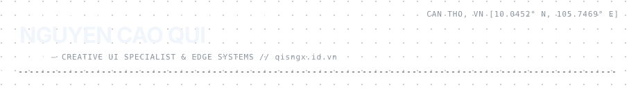

 

# NGUYEN CAO QUI (QuiNC) — Creative Frontend Architect & Interaction Systems Engineer

I am a **Creative Frontend Architect** and **AI-Augmented Software Engineer** based in Can Tho, Vietnam [10.0452° N, 105.7469° E]. My technical discipline centers on building high-performance web applications, GPU-accelerated graphics pipelines, and edge-native architectures.

* **Core Philosophy**: Precision & Architecture — meticulous craftsmanship from underlying data structures and AST call graphs to sub-pixel rendering.
* **Engineering Paradigm**: AI-Augmented Software Engineering (Vibe Coding) — shifting development leverage from manual line-by-line syntax writing to architectural synthesis, algorithmic validation, and continuous quality governance.
* **Academic & Professional Foundation**: GPA > 8.0, backed by university specializations in UX Research & Design (University of Michigan), Project Management (UC Irvine), Software Development Lifecycle (University of Minnesota), and Artificial Intelligence (DeepLearning.AI).

 

 

## Systems Architecture & Technical Capabilities

| Domain | Core Technologies & Architectural Invariants |
| :--- | :--- |
| **Frontend Architecture** | Nuxt 3 (SSR/SSG), Vue 3, React 19, Next.js 16, TypeScript, Tailwind CSS |
| **Interactive & GPU Graphics** | WebGL 2.0, Custom GLSL Shaders, Web Audio API (FFT), Canvas 2D/3D, MindAR WebAR |
| **Motion Engineering** | Rossark Harmonic Motion (Calm by default, continuous interpolation, arcs) |
| **Edge & Serverless** | Cloudflare Pages, Workers KV, D1 SQLite, OpenNext.js, Edge REST & RPC APIs |
| **Systems & Native** | Python 3.12, Win32 API (Kernel hooks / `SetThreadExecutionState`), PyInstaller |
| **Enterprise Backend** | C# .NET 8, ASP.NET Core Web API, EF Core, SQL Server, Clean Architecture |

## Complete Systems Archive (21 Compiled Projects)

A structured, flat directory of all 21 production platforms, WebAR applications, interactive simulations, and systems utilities.

### 01 / Enterprise & Commercial Platforms

| Project & Award | Role & Scope | Core Technology | Live Production | Architectural Highlight |
| :--- | :--- | :--- | :--- | :--- |
| **Song Hau Biotech** | Solo Outsource | Next.js 16, React 19, OpenNext, Cloudflare | [songhau.vn ↗](https://songhau.vn) | Enterprise agricultural biotech portal; sub-25ms TTFB on global Edge KV. |
| **Terra Mark** | Frontend (ResFes 2026 Prize) | MindAR, Next.js 16, React 19, Tailwind | [terramark.io.vn ↗](https://terramark.io.vn) | Mobile WebAR dual-target camera tracking for real-time plastic classification. |
| **StoryLab Creative** | Solo Outsource | Next.js 16, React 19, Lenis, Framer Motion | [storylabcreative.id.vn ↗](https://storylabcreative.id.vn) | Editorial multimedia branding agency platform with kinetic type transitions. |
| **Tây Tới Bến** | Frontend (ColorUp 2026 Prize)| React 18, Vite 5, SVG Coordinate Mapping | [taytoiben.pages.dev ↗](https://taytoiben.pages.dev) | Mekong Delta cultural exploration hub featuring 3D vector passport stamps. |
| **QuiNC Portfolio** | Solo Architect | Nuxt 3 (SSR), Vue 3, Tailwind v4, i18n | [qisngx.id.vn ↗](https://qisngx.id.vn) | High-performance architectural hub, 100% semantic CSS, zero layout shift. |
| **Palmora Quiz** | Solo Developer | React, Vite, Tailwind CSS, Cloudflare | [palm-ora.pages.dev ↗](https://palm-ora.pages.dev) | Adaptive trivia assessment suite with instant client-side evaluation loops. |

### 02 / Creative Audio-Visual, Games & Web Experiments

| Project | Category | Core Technology | Live Demonstration | Architectural Highlight |
| :--- | :--- | :--- | :--- | :--- |
| **Sonolux** | Audio-Visual | WebGL 2.0, GLSL, Web Audio API (FFT) | [sonolux.pages.dev ↗](https://sonolux.pages.dev) | 50,000+ particles GPU simulation; 60.0 FPS locked; zero-alloc audio uniform stream. |
| **Word Forge** | EdTech Game | React 19, Framer Motion, Web Speech API | [word-forge.pages.dev ↗](https://word-forge.pages.dev) | Timber Woodcraft Golem character motion rig; procedural oscillator synthesis. |
| **Meme Onet** | Arcade Game | Vue 3, HTML5 Canvas, Web Audio API | [meme-onet.pages.dev ↗](https://meme-onet.pages.dev) | Tactile connect-2 tile matrix engine with zero-latency audio dispatching. |
| **Mekong Connect** | Cloud Platform | Cloudflare Workers, Edge KV, REST API | [workers.dev ↗](https://mekongconnect.quinc-ce190986.workers.dev/) | Regional event telemetry & live data distribution running at network edge. |
| **Bloom Sanctuary**| 3D Interactive | Three.js / Canvas, CSS 3D Transforms | [khu-vuon-20-10.pages.dev ↗](https://khu-vuon-20-10.pages.dev) | Procedural flower petal geometry and harmonic blooming animation curves. |
| **Neon Chance** | Interactive | HTML5 Canvas, Web Audio, Vite | [github.io ↗](https://quinc-dev.github.io/entropy-nexus/) | Physics-driven entropy & probability simulation chamber. |
| **1st June Portal**| Interactive | Cloudflare Workers, Inline Dynamic SVG | [workers.dev ↗](https://quoctethieunhi.quinc-ce190986.workers.dev/) | Procedural celebratory particle fireworks rendered directly from edge workers. |
| **8th March Greeting**| Interactive | React, Framer Motion, Cloudflare Pages | [8th-march.pages.dev ↗](https://8th-march.pages.dev/) | Kinetic typography and interactive card origami greetings. |

### 03 / AI Engineering & Windows System Utilities

| Project | Domain | Core Technology | Repository / Deployment | Architectural Highlight |
| :--- | :--- | :--- | :--- | :--- |
| **Lucid — Keep-Awake** | Windows Utility | Python 3.12, Win32 API, CustomTkinter | [Docs ↗](https://quinc-dev.github.io/lucid-keepawake/) \| [Repo ↗](https://github.com/quinc-dev/lucid-keepawake) | Win32 `SetThreadExecutionState` kernel lock, zero mouse cursor jitter. |
| **Wifi Rescue** | System Security | Python, Windows API, netsh engine | [Docs ↗](https://quinc-dev.github.io/WifiRescue/) \| [Repo ↗](https://github.com/quinc-dev/WifiRescue) | 1-Click WPA2/WPA3 Enterprise 802.1X profile backup & disaster recovery. |
| **Mini GraphRAG** | AI Architecture | Python, NetworkX, LightRAG API | [quinc-dev/mini-graphrag ↗](https://quinc-dev.github.io/mini-graphrag/) | Compact graph-based knowledge retrieval engine for local LLM pipelines. |
| **FUO Quiz Toolchain**| EdTech Pipeline | Python, PyPDF, Regex Pipeline | [quinc-dev/fuo-quiz-toolchain ↗](https://quinc-dev.github.io/fuo-quiz-toolchain/) | Automated examination document parsing and gift-format question generator. |

## Professional Specializations & Certifications

Verified specializations completed through Coursera from leading universities:

* **UX Research & Design Specialization** — University of Michigan
* **Project Management Principles & Practices** — University of California, Irvine (UC Irvine)
* **Software Development Lifecycle (SDLC) Specialization** — University of Minnesota
* **Web Design for Everybody: Basics of Web Development & Coding** — University of Michigan
* **AI for Everyone** — DeepLearning.AI
* **Academic Skills for University Success** — The University of Sydney

## Connect & Architectural Verification

* **Official Architecture Hub**: [qisngx.id.vn](https://qisngx.id.vn)
* **GitHub**: [github.com/quinc-dev](https://github.com/quinc-dev)
* **LinkedIn**: [linkedin.com/in/nguyen-cao-qui](https://linkedin.com/in/nguyen-cao-qui)
* **GitLab**: [gitlab.com/quinc.ce190986](https://gitlab.com/quinc.ce190986)
* **Direct Communication**: [quinc.ce190986@gmail.com](mailto:quinc.ce190986@gmail.com)

 
Crafted with Precision Engineering // Zero AI-Slop // Can Tho, Vietnam

